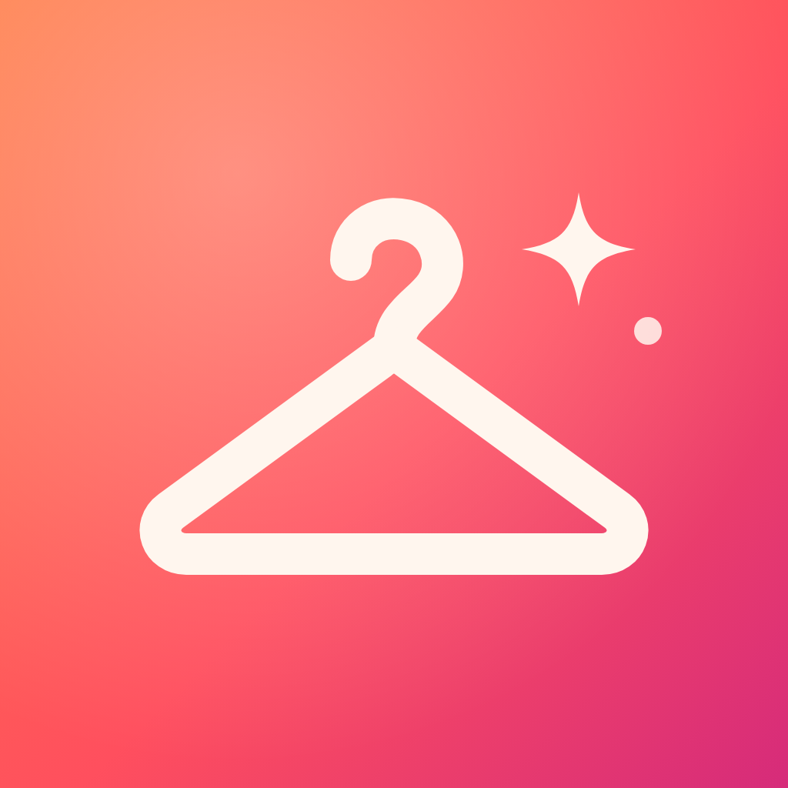

<p align="center">
  
</p>

<h1 align="center">OutfitSim</h1>
<p align="center"><em>Your closet, on you.</em></p>

OutfitSim is an iOS app (iPhone, iOS 17+) that turns photos of your clothes into a digital closet,
lets you remix the pieces into unlimited outfits, and shows them on an avatar wearing **your face,
scaled to your real proportions**. Everything runs on-device.

## Features

- **Separate pieces from photos.** Photograph an outfit you're wearing (full body) or clothes laid
  flat. A Core ML clothing parser labels every pixel (top, trousers, skirt, dress, shoes, hat,
  sunglasses, bag, scarf, belt); edges are refined with Apple Vision's person matte. Flat-lays use
  Vision subject lifting (with a background-keying fallback). Each piece is cut out automatically.
- **Review and clean up.** Untick pieces you don't want, rename or re-categorise them, erase/restore
  edges with a brush, and adjust each piece's *fit guides* with a live try-on preview.
- **Reassemble into outfits.** The Studio canvas dresses the avatar: tap pieces to wear them, drag /
  pinch / rotate to adjust, reorder layers, tuck tops in, shuffle, save, share.
- **Mix my closet.** The generator builds varied outfits (top + bottom or dress, shoes, optional
  layers and accessories), ranked by colour harmony, optionally "built around" locked pieces.
- **Your face, in proportion.** Add a selfie: the head and hair are cut out, the eye line is levelled,
  and the head is scaled so it is exactly one anthropometric head height for *your* stature.
  Alignment guides and fine-tuning sliders let you verify and adjust it.

## How proportions stay aligned

All placement happens in *body space*: one unit = your height, `y = 0` the top of the head, `y = 1`
the floor.

| Piece | Aligned by |
| --- | --- |
| Avatar body | Drillis & Contini segment ratios (shoulder 0.818 H, hip 0.530 H, knee 0.285 H, …); head height grows allometrically with stature (22.75 cm × (H/175)^0.4), so a 150 cm person is ~7.0 heads tall and a 190 cm person ~8.1 |
| Your face | Eye line levelled; eye-to-chin height = half a head (pupil distance also used for front-facing photos); chin pinned to the neck; uniform scale only, so the face is never distorted |
| Tops, coats, dresses | Shoulder seams → avatar shoulders (from body-pose joints for worn photos, from the garment outline for flat-lays) |
| Trousers, skirts | Waistband (or hips) → avatar waist; full-length pieces also hem → ankle, with at most 15% anisotropy |
| Shoes, bags, belts, scarves | Soles on the floor / handle at the hand / waist / neck; pieces cut from a photo of a person keep their size relative to that person's shoulders |
| Hats, glasses | Brim / eye line on the head; sized relative to the photographed person's head |

Every placement is a pure function in `OutfitCore` with unit tests (e.g. the placed head is one head
height tall for every stature and photo resolution; trouser hems land at the ankle; soles touch the
floor). Implausible measurements are clamped to realistic sizes.

## Install the IPA

Each CI run on GitHub Actions produces an **unsigned** `OutfitSim-unsigned.ipa` artifact
(Actions → latest run → *OutfitSim-ipa*). Unsigned IPAs must be signed when installed:

- **Sideloadly** or **AltStore** (free Apple ID; apps expire after 7 days), or
- your own Apple Developer account (see below), or a re-signing tool of your choice.

### Signed builds from CI (optional)

Add these repository secrets and CI also produces `OutfitSim-signed.ipa`:

| Secret | Value |
| --- | --- |
| `IOS_CERTIFICATE_P12` | base64 of your signing certificate + private key (`.p12`) |
| `IOS_CERTIFICATE_PASSWORD` | the `.p12` password |
| `IOS_PROVISIONING_PROFILE` | base64 of the `.mobileprovision` |
| `IOS_TEAM_ID` | your Apple Developer team ID |

Optional repository variables: `IOS_BUNDLE_ID` (must match the profile) and `IOS_EXPORT_METHOD`
(`release-testing` default, `debugging`, `app-store-connect`, `enterprise`).

## Build from source (Mac)

Requirements: Xcode 26, Python 3.12, [XcodeGen](https://github.com/yonaskolb/XcodeGen) (`brew install xcodegen`).

```sh
scripts/bootstrap.sh          # converts the clothing parser to Core ML, generates the Xcode project
open OutfitSimulator.xcodeproj
```

The model conversion (`Models/convert_clothing_parser.py`) downloads a pinned revision of
`mattmdjaga/segformer_b2_clothes`, bakes in normalisation and argmax, quantises weights to 8 bits
(~27 MB) and can validate Core ML against PyTorch (`--validate-image photo.jpg`; CI requires ≥ 97%
pixel agreement — it measures 99.97%).

## Tests

| Suite | Where | What |
| --- | --- | --- |
| `OutfitCoreTests` | Linux + macOS (`swift test --package-path Packages/OutfitKit`) | geometry, anthropometry, garment & face fitting, masks/brushes, anchor estimation, colour, generator, scene, persistence |
| `OutfitKitTests` | macOS | ImageIO/orientation, rendering, background keying, the clothing parser on real photos, garment extraction (worn + flat-lay), face landmarks, head cut-out alignment, full composites |
| `OutfitSimulatorUITests` | iOS Simulator | full journey: onboarding → face → import → review/editor → closet → Studio → save → outfits → generator → profile, with screenshots |

CI (`.github/workflows/ci.yml`) runs all of them, uploads UI screenshots and preview renders, and
packages the IPA (checking that the model is bundled and test photos are not).

## Project layout

```
App/                    SwiftUI app (brand, model, views, assets)
Packages/OutfitKit/
  Sources/OutfitCore/   platform-independent logic (fitting, avatar, generator, store)
  Sources/OutfitKit/    Vision / Core ML / Core Graphics layer
Models/                 clothing-parser conversion script
UITests/                end-to-end UI test
scripts/                bootstrap, IPA packaging and signing
project.yml             XcodeGen project definition
```

## Privacy

Photos are processed on the device and stored in the app's private container. Nothing is uploaded.

## Licences and notices

- The clothing parser is derived from **SegFormer** (© NVIDIA, *NVIDIA Source Code License — non-commercial
  use only*) fine-tuned on the **ATR** human-parsing dataset (research use). The converted model is
  generated at build time and is not stored in this repository. Commercial distribution of the app
  would require replacing this model with one licensed for commercial use.
- Test photos: see `Packages/OutfitKit/Tests/OutfitKitTests/Fixtures/LICENSES.md` (CC0 and Unsplash
  License). Copies are bundled in Debug builds only, for UI tests.
